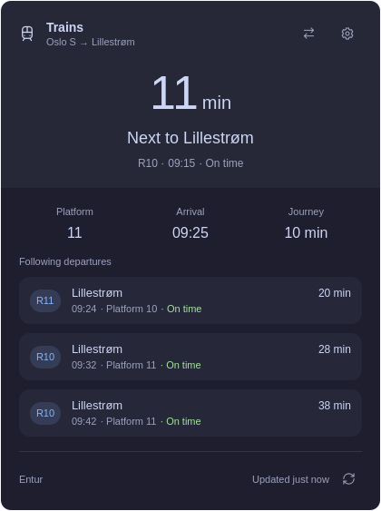

# Foamy Train

Direct trains in Norway, with live departures, delays, and service notices.



## Install

Requires Omarchy 4.5 (also loads on Omarchy 4.0), Python 3.10 or newer, and GNU
coreutils. No API key is needed.

```sh
omarchy plugin add https://github.com/foamrider/foamy-train.git --enable
```

## Use

1. Open **Settings** (the cog, `s` in the popup, or right-click the bar widget)
   and search for your **From** and **To** stations.
2. Select both results. Settings save automatically.
3. Use the arrows beside the cog to switch direction.

Left-click opens departures. In the popup, arrows or `hjkl` move the cursor,
Enter or Space expands a service notice or presses the highlighted button,
`r` refreshes, Esc closes and Tab moves to the next bar panel. A yellow
countdown means the train is delayed.

## Settings

- **Show minutes in the bar**: countdown next to the train icon.
- **Show trains in the next**: 1 to 24 hours (default 24). Only direct trains
  are shown; longer countdowns use hours and minutes.
- **Refresh every**: 30 seconds to 15 minutes (default 1 minute).
- **Use a weekly schedule**: per-day time ranges (local time, overnight ranges
  carry into the next day). Outside the schedule the widget dims or hides and
  stops fetching.

## Network use

Departures come from Entur's journey planner. To keep requests light:

- The configured interval applies while the popup is open or the next train
  leaves within 30 minutes. With the popup closed, the widget checks every
  5 minutes when the next train is within 2 hours, and every 15 minutes
  otherwise (never more often than your interval).
- Each request first searches 3 hours ahead and widens to the full window only
  when that finds fewer than six direct trains (sparse routes, late evening).
- Nothing is fetched while the screen is locked. Before each unattended
  check the widget asks the lock screen through the public `lock isLocked`
  IPC target (answered by Omarchy's lock and by Foamy Lock); opening the
  popup or pressing Refresh always fetches.
- One request runs per shell, however many monitors show the bar.
- After a connection comes up, requests wait briefly for DNS and routes.
  Temporary failures retry up to three times with increasing delays. Cached
  departures stay visible offline, marked as cached once two polls in a row
  are overdue.

Your stations and preferences stay in Omarchy's `shell.json`. Station searches
and selected station IDs are sent to Entur. The station pair is passed to the
helper on stdin, so it does not appear in the process list. No account or
location permission is needed.

## IPC

`omarchy-shell foamy.train <open|close|toggle|settings|refresh|swap|status>`.

## Remove

```sh
omarchy plugin remove foamy.train
```

Removal stops departure requests. Cached departure data remains on disk;
there is no Entur account or subscription to cancel.

Omarchy manages the plugin entry in `shell.json`. Packages and data outside
the plugin directory are retained unless you remove them separately.

## License

Data: [Entur](https://developer.entur.no/docs/open-services/journey-planner), NLOD.
Code: [MIT](LICENSE), with [Omarchy](LICENSE-OMARCHY) and [Lucide](LICENSE-LUCIDE) notices.

Provided **as is**, without warranty or guaranteed support. Use at your own risk.

Language follows **Omarchy → Setup → Language** on Omarchy 4.5 (English and
Norwegian catalogs; other languages fall back to English). Omarchy 4.0 displays
the plugin in English.

## Development

`kit/` holds shared components copied from [foamy-kit](https://github.com/foamrider/foamy-kit); edit them there, not here.

Shared foamy components live in `kit/` (copied from
[foamy-kit](https://github.com/foamrider/foamy-kit); never edit them here).

```sh
node --test tests/*.test.cjs
python3 -m unittest discover -s tests -p 'test_*.py'
bash tests/kit-check.sh
python3 tests/i18n-runtime.py            # OMARCHY_PATH=<4.5 tree> for live language switching
python3 tests/runtime.py both            # offscreen, needs foamy-kit (FOAMY_KIT)
foamy-kit/preview/render.py . --host both
foamy-kit/preview/render.py . --preview preview/BarPreview.qml
```
