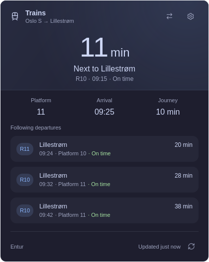

# Foamy Train

Direct trains in Norway, with live departures, delays, and service notices.



## Install

Requires Omarchy 4.5, GNU coreutils, and an x86_64
or aarch64 CPU: the plugin ships a prebuilt static helper for both, and on other
CPUs the widget says the helper isn't available. HTTPS to Entur needs AES,
carry-less multiply, AVX2, BMI2 and ADX on x86-64 (Intel Broadwell, AMD Zen or
newer), or the crypto extensions on ARMv8 (a Raspberry Pi 5, not a Pi 4);
without them the widget says HTTPS isn't supported on this CPU. No API key is
needed.

```sh
omarchy plugin add https://github.com/foamrider/foamy-train.git --enable
```

## Use

1. Open **Settings** (in the ⋯ menu, `s` in the popup, or right-click the bar widget)
   and search for your **From** and **To** stations.
2. Select both results. Settings save automatically.
3. Use the arrows beside the ⋯ button (or **Switch direction** in Settings) to
   switch direction.
4. **Snooze until tomorrow** (in the ⋯ menu): mutes the widget until
   tomorrow, like being outside the schedule. A snooze lasts until today's
   scheduled hours end (an overnight range runs on past midnight), or until
   midnight without a schedule. Snoozed, the entry reads **Stop snoozing**;
   outside the schedule it reads **Resume now** and turns the widget on until
   midnight (or until the schedule starts, if sooner). Either goes back to
   the schedule when pressed again. Snoozing is kept in
   `$XDG_STATE_HOME/foamy-train/schedule-override.json`, never in `shell.json`.

Left-click opens departures. In the popup, arrows or `hjkl` move the cursor,
Enter or Space expands a service notice or presses the highlighted button,
`r` refreshes, Esc closes and Tab moves to the next bar panel. A yellow
countdown means the train is delayed.

## Settings

- **Show minutes in the bar**: countdown next to the train icon.
- **Show trains in the next**: 1 to 24 hours (default 24). Only direct trains
  are shown; longer countdowns use hours and minutes.
- **Refresh every**: 30 seconds to 15 minutes (default 1 minute).
- **Use a weekly schedule**: per-day time ranges (local time, overnight ranges
  carry into the next day). Outside the schedule (or snoozed) the widget dims
  or hides and stops fetching in the background. Opening the popup still
  fetches and shows the departures, and keeps them fresh while it is open.

## Network use

Departures come from Entur's journey planner. To keep requests light:

- The configured interval applies while the popup is open or the next train
  leaves within 30 minutes. With the popup closed, the widget checks every
  5 minutes when the next train is within 2 hours, and every 15 minutes
  otherwise (never more often than your interval).
- Each request first searches 3 hours ahead and widens to the full window only
  when that finds fewer than six direct trains (sparse routes, late evening).
- Nothing is fetched while the screen is locked. Before each unattended
  check the widget asks the lock screen through the public `lock isLocked`
  IPC target (answered by Omarchy's lock and by Foamy Lock); opening the
  popup or pressing Refresh always fetches.
- One request runs per shell, however many monitors show the bar.
- Each check runs the helper once; it prints one reply and exits, so nothing
  stays running between checks. A reply younger than 30 seconds is served
  from the cache unless you press Refresh.
- After a connection comes up, requests wait briefly for DNS and routes.
  Temporary failures retry up to three times with increasing delays. Cached
  departures stay visible offline, marked as cached once two polls in a row
  are overdue.

Requests use the system's trusted certificates and honour `https_proxy` and
`no_proxy`.

The popup draws every station and notice it is given, so replies are held to
small limits: by the helper while it reads Entur's answer (and when it reads
a cached report, including one an older version wrote), and again by the
widget for every reply it gets:

- at most 8 stations per search, 6 departures, 3 notices on a departure and
  5 route notices, counted after duplicates are dropped;
- notice summaries up to 200 characters, details 600, scope labels 100, ids
  100, line and platform codes 20 and station labels 160. Longer text is cut
  and ends in "…".

When a notice is left out, the popup says **Some notices are not shown.**

Your stations and preferences stay in Omarchy's `shell.json`. Station searches
and selected station IDs are sent to Entur. The station pair is passed to the
helper on stdin, so it does not appear in the process list. No account or
location permission is needed.

## IPC

`omarchy-shell foamy.train <open|close|toggle|settings|refresh|swap|snooze|status>`
(`snooze` is the ⋯ menu's snooze entry).

## Verifying the helper binaries

`bin/x86_64/foamy-train-helper` and `bin/aarch64/foamy-train-helper` are compiled from the Rust source in this repository: `native/`, the
shared crate in `kit/rust/`, the dependencies locked in `Cargo.lock` and the
toolchain pinned in `rust-toolchain.toml`, with the build tool in
`kit/native/`. The build is reproducible. `native/native.pin` records the
toolchain, a hash of every build input (`source`) and the SHA-256 of each
binary.

**CI.** The [Verify native helpers](https://github.com/foamrider/foamy-train/actions/workflows/verify-native.yml)
workflow rebuilds both binaries on a GitHub-hosted runner for every push,
compares them byte for byte with `bin/`, and attests the rebuilt files. To
check the committed files against that attestation (GitHub CLI):

```sh
gh attestation verify bin/x86_64/foamy-train-helper --repo foamrider/foamy-train \
  --signer-workflow foamrider/foamy-train/.github/workflows/verify-native.yml \
  --deny-self-hosted-runners
gh attestation verify bin/aarch64/foamy-train-helper --repo foamrider/foamy-train \
  --signer-workflow foamrider/foamy-train/.github/workflows/verify-native.yml \
  --deny-self-hosted-runners
```

Add `--source-digest <commit>` to require a particular commit.

**Yourself.** You need `rustup`, Python 3.11 or newer and `file`. From a
checkout of this repository at the commit you want to check:

```sh
rustup toolchain install "$(awk '$1 == "toolchain" { print $2 }' native/native.pin)" \
  --profile minimal --target x86_64-unknown-linux-musl,aarch64-unknown-linux-musl
kit/native/build-native.sh . --verify
```

It builds both binaries from scratch in `~/.cache/foamy-native/` (nothing is
written to the checkout), compares them byte for byte with `bin/`, checks
that the kit files are unmodified and that `native.pin` matches the source,
and ends with `verify OK (foamy-train-helper, <toolchain>, both arches reproducible)`.

### Building the helper yourself

To run binaries you built instead of the committed ones, build them in the
installed plugin with the same toolchain, then run `omarchy restart shell`:

```sh
cd ~/.config/omarchy/plugins/foamy.train
kit/native/build-native.sh .
```

The build is reproducible, so `git status` shows no change when your
binaries match the release, and `omarchy plugin update` still applies.

## Remove

```sh
omarchy plugin remove foamy.train
```

Removal stops departure requests. Cached departure data remains in
`~/.cache/foamy.train/`, and a snooze, if you used one, in
`~/.local/state/foamy-train/schedule-override.json`; there is no Entur
account or subscription to cancel.

Omarchy manages the plugin entry in `shell.json`. Packages and data outside
the plugin directory are retained unless you remove them separately.

## License

Data: [Entur](https://developer.entur.no/docs/open-services/journey-planner), NLOD.
Code: [MIT](LICENSE), with [Omarchy](LICENSE-OMARCHY) and [Lucide](LICENSE-LUCIDE) notices.

Provided **as is**, without warranty or guaranteed support. Use at your own risk.

Language follows **Omarchy → Setup → Language** on Omarchy 4.5 (English and
Norwegian catalogs; other languages fall back to English).

## Development

Shared foamy components live in `kit/` (copied from
[foamy-kit](https://github.com/foamrider/foamy-kit); never edit them here).

Departures and station search run `bin/<arch>/foamy-train-helper`, a Rust
helper built from `native/` (its contract is the comment at the top of
`native/src/main.rs`). The binaries are committed; after changing `native/` or
syncing the kit, rebuild and commit them with `native/native.pin` (needs rustup,
see the kit's "Native helpers"; no C compiler: HTTPS uses the kit's `tls`
module, Graviola crypto in Rust and assembly):

```sh
kit/native/build-native.sh . --test   # fmt, clippy, cargo test
kit/native/build-native.sh .          # both arches, writes native/native.pin
kit/native/build-native.sh . --verify # clean rebuild is byte-identical
```

Tests (Python 3, node and the openssl CLI are needed for development only).
The Python tests run the helper as a process against a local fake Entur
(`tests/fake_entur.py`); `FOAMY_TRAIN_ENTUR_URL`, a loopback base URL, is the
helper's test-only endpoint override, and `FOAMY_HELPER` (a JSON argv prefix)
picks the binary:

```sh
node --test tests/*.test.cjs
python3 -m unittest discover -s tests -p 'test_*.py'
FOAMY_HELPER='["bin/aarch64/foamy-train-helper"]' python3 -m unittest discover -s tests -p 'test_*.py'  # via qemu binfmt
bash tests/kit-check.sh
python3 "$FOAMY_KIT/preview/i18n_runtime.py" .   # the catalogs under a live language switch
python3 tests/runtime.py                 # offscreen, needs foamy-kit (FOAMY_KIT)
python3 tests/cursor.py                  # popup cursor vs the 1 s clock (offscreen)
FOAMY_HOST_45=/usr/share/omarchy/shell foamy-kit/preview/render.py . --host 4.5
FOAMY_HOST_45=/usr/share/omarchy/shell foamy-kit/preview/render.py . --host 4.5 --preview preview/BarPreview.qml
```

The offscreen tests run on Omarchy 4.5, the installed `/usr/share/omarchy/shell`
(`FOAMY_HOST_45` picks another 4.5 tree). They also run on 4.0 when
`FOAMY_HOST_40` names a 4.0 shell tree; otherwise they print a SKIP line for it.
